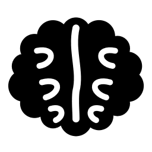

# Mental Board

An infinite canvas for your head. Drop a note anywhere, write in it properly,
drag it about, rope it to another, and fence groups of them into named
workflows you can jump between from anywhere on the board. Drop a picture and
it stands on the board by itself. Every board is a folder you can find, copy
and share.

**2.0** is a rework: a new look (the "Mental Board" theme — dark, hairlines,
a settings panel that explains itself), a page menu at the top right of every
board, pictures that live on the board and drop into notes, boards kept as
folders in `Documents\My Boards`, groups, and a lighter touch on a slow
machine. Your 1.x board is read into the new layout the first time 2.0 starts,
and the old file is left where it was.

**2.1** draws on the board — pen, marker, brush and eraser (`P`) — and makes
ropes something you travel along: press one and you fly to the note at the
other end. Notes lose their head row (everything is on right-click), text links
land where the caret is and can point at a note, columns keep their shape,
copies keep their ropes, and holding `Ctrl V` shows where a paste will land. A
workflow can be locked behind the notes, the wheel scrolls a long note, menus
can make sounds (off by default), a note or workflow can take any colour from the colour window, links are blue, graphics picks one of three tiers for the
machine, the accent defaults to white on dark and black on light, and a theme
change fades.



## Getting it running

```bash
npm install
npm start
```

`npm start` is the everyday way in. It runs the code as it is on disk right
now, against your real board — no build step, no install, and edits show up on
`Ctrl+R`.

To build the app you double-click:

```bash
npm run build
```

That writes **`App\Mental Board.exe`**. Double-click it. No installer, no
shortcut, nothing in Add/Remove Programs, and your boards stay in
`Documents\My Boards`.

If you want it one click away, make a shortcut to that exe yourself — the build
never creates, moves or overwrites one, so it stays yours.

`admin\` has all of it as double-clickable scripts: **Build App**, **Run Mental
Board**, **Run Sandbox**, **Check Everything**, **Backup Board**, **Open Data
Folder**. Each one explains itself in its own first few lines.

## Updating

**Run `admin\Build App.cmd`.** That is the whole update mechanism.

It deletes `App\` and rebuilds it from the current source, so the thing you
double-click is always the code in this folder.
`App\BUILD.txt` records the version and the minute it was built, and the
version sits in the titlebar, so you can always confirm you are looking at the
build you just made.

Nothing downloads anything. There is no installer, no auto-updater and no
release feed, and that is deliberate.

> **What went wrong in 1.3.** It shipped an NSIS installer, a portable exe that
> self-extracted to `%TEMP%` on every launch, and an auto-updater that staged a
> new version from GitHub Releases. Between them, one machine could be holding
> four different builds of this app at once — and a shortcut opens exactly one
> of them, with nothing on screen to say which. Rebuilding looked like it did
> nothing.
>
> Worse, a bug in the save path meant that once a single write to `board.json`
> failed, the app quietly decided nothing had changed and stopped saving for the
> rest of the session — with no error, ever. Close the window and the work went
> with it. Reopen and the board was exactly as you left it *before* you started,
> which reads as "the update wiped my notes".
>
> 1.4 deletes the first problem — one copy, one path, one command — and fixes
> the second: a write that fails is retried, and says so on screen instead of
> failing silently.

## What's in it

**The page menu.** The board's name sits at the top right of the canvas; click
it and everything about *this* board is there. The font its notes are set in
(seven faces, shown as samples), small text, a background picture with a fit
and a dimmer, copy everything on the board (`Ctrl+Shift+C`), duplicate, move
it into a group, move it to the trash, import a board, export this one as a
folder or as a picture, open its folder, lock, archive. Settings (`Ctrl+,`)
stays the place for the app; this is the place for the page.

**Pictures on the board.** Drop or paste a picture onto empty canvas and it is
just the picture — no note around it. Drag it, rope it, group it, resize it
from any handle and it keeps its shape, double-click it to crop or draw on
it. Drag it onto a note and it goes inside; the image toolbar's arrow button
takes it back out.

**Videos.** Drop a clip on the canvas, or use **+ → Video…**, right-click empty
space → *Add a video…*, or `/video` → *A video on this computer…* inside a note.
The clip is copied into the board's folder, the note is sized to the clip's own
shape, and it plays in place. A format Windows can play but the app cannot
(most `.avi`, some `.mkv`) says so and offers to open it in your player.

**Dates.** Right-click a note → *Date*: Today, Tomorrow, Next week, or any day
from the field. The date sits beside the status on the note — amber on the day,
red once it has passed, plain again when the note is done. *Show only what is
due* fades out everything that is not overdue or due today.

**The agenda** (`Ctrl+Shift+D`, or the calendar button on the zoom bar). Every
dated note on every board, under Overdue, Today, Tomorrow, This week and Later,
with a month beside it marking the busy days. Click a day for just that day,
click a row to fly to the note, tick it to mark it done.

**The board as columns** (`Ctrl+Shift+K`, or the button beside it). One column
per status, cards in date order. Drag a card to another column to change its
status; click it to go to the note.

**The minimap.** The whole board in the bottom-right corner, with the part on
screen framed. Click or drag on it to go there. Settings → Canvas turns it off.

**Obsidian.** The page menu has *Export for Obsidian (.canvas)* and *Import a
.canvas*. A board goes out in the open JSON Canvas format with its pictures and
clips in a folder beside it, and notes become Markdown; drop both into a vault
and Obsidian opens it. Coming in, a `.canvas` (picked, or dropped on the board)
becomes a new board, with the files it names found in the vault and copied in.

**Boards.** A small window in the top-left corner holds one row per board — one
for work, one for the gym, one that is nobody else's business. Click a row to
switch. Hover it and three buttons appear at its end: an icon picker, a pencil
that renames it in place, and a ⋯ for everything else — duplicate, archive,
lock, export, delete. None of that is behind a right-click any more, though
right-click still works everywhere it used to. `Ctrl+B` opens the window from
the keyboard. Each board keeps its own notes and its own viewport, so switching
puts you back exactly where you left off.

Settings has three ways to show it. **On hover** is the default, and it gets
out of the way completely: at rest there is nothing in the corner at all. Move
the pointer to the top-left of the canvas and the boards button fades in; keep
going and the list flies out, sized to exactly what is in it and growing as you
add boards, never a panel with empty space in it. Move away and it is gone
again. Click the button to latch it open. It shows itself for a couple of
seconds when the app starts so you know it is there. **Always** gives you the
full column down the edge instead, and **Hidden** takes it away entirely.

**The canvas.** Pans and zooms forever. Scroll to zoom, hold space (or the
middle button, or Alt) and drag to pan. Nothing is ever off the edge of
anything.

**It stays quick when the board gets big.** Past about sixty items only the
notes near what you are looking at are actually in the page, and they mount and
unmount as you pan; the ropes between them are culled the same way, and a drag
only redraws the ones it is actually moving. Zoom far enough out that the text
is unreadable and the text stops being drawn at all, leaving the coloured shapes
you were looking for. Moving a note remembers four numbers rather than a copy of
the whole board, so an afternoon of dragging things around does not slowly eat
your memory. Find and the jump palette read each note once instead of once per
keystroke. The save is debounced longer on a big board, skipped entirely when
nothing changed, and written off the interface thread so a slow disk never
freezes the window mid-sentence. Thousands of notes on an old laptop with a
spinning disk is the case this is built for.

**A copy that is not on this disk.** Settings → Your board → *Backup copy*.
Choose a folder once — a synced drive, a stick, a share — and the app writes a
dated copy there, once a day when it starts, keeping the newest ten. Everything
else the app does to protect your board sits in the same folder as the board,
which protects it from you and not from the drive. This is the other half. It
tells you where the copies go and when the last one landed, and if it ever
fails it says so rather than going quiet.

**Files and documents.** Drop a spreadsheet, a PDF or a deck on the canvas and
you get a note for it. The file is copied into the board's own `files` folder,
so the board still has it when the original moves — and a board copied to a
stick takes its documents with it. `Ctrl+K` accepts a path like
`C:\\Reports\\Q3.xlsx` as well as a web address. Documents open in whatever
Windows uses for them; anything that could *run* is shown in its folder
instead, never launched.

**Pictures of a board.** *Save as image…* draws the whole board — every note,
its colour, its status and date, the pictures standing on it, and the ropes
between them. It is drawn in a light
theme by default even if you work in a dark one, because a picture is for
somewhere else: a deck, an email, a printer. Settings → Your board → *Board
picture* changes that, including back to matching the app.

**Graphics.** Settings → Canvas has **Auto · Full · Light**. Auto looks at the
machine and picks. Light keeps the layout, the colours, the type and the
spacing exactly as they are and only stops doing the expensive per-pixel work —
blurred shadows become crisp edges, background blur goes, canvas animation
stops. It is the same design drawn with cheaper ink, not a stripped-down mode,
and Auto will tell you which one it chose for you.

**Notes.** Hit `+` bottom-left, press `N`, or double-click empty space.
Double-click a note to write in it.

**Your own templates.** Lay a note out the way you like it — a workout table, a
meeting sheet, whatever you actually use — then right-click it and choose **Save
as template**. It comes back as a one-click card on any empty board, in the `/`
menu mid-sentence, and in the jump palette. Settings lists them all with a
button to insert and a button to delete. There are no templates in the box: the
ones you get are the ones you make.

**Writing.** A Notion-style block editor. Type `/` for the block menu —
headings, to-do checkboxes, code blocks, quotes, callouts, dividers, tables,
images, icons, links, and your own templates. Or use the markdown shortcuts:
`# `, `## `, `### `, `- `, `1. `, `[] `, `> `, ` ``` `, `---`. Select text and a
toolbar appears for bold, italic, underline, strikethrough, inline code,
headings, highlighting, and text size — step it with A−/A+ or type an exact
pixel value in the box between them. Headings toggle: click H1 again to go back
to plain text. `Ctrl+K` adds a link.

**Tables.** `/table` drops in a real table. `Tab` moves to the next cell and
falls off the end into a new row; `Shift+Tab` goes back. A toolbar appears while
the caret is inside one, for adding and removing rows and columns and for
sorting by the column you are in — numbers sort as numbers, text sorts in your
own language, blanks sink. Paste a table in from a web page or a spreadsheet and
it stays a table.

**Finding things.** `Ctrl+F` searches **every** board, not just the one you are
looking at, and switches when you land on a hit somewhere else. `Ctrl+P` opens a
jump palette: type a few words to go to any note, any board, or an action.

**Getting things in.** `Ctrl+Alt+N` anywhere in Windows opens a one-line box on
top of whatever you are doing; what you type lands on a board of your choosing.
Turn on a **daily note** and each morning starts with a dated one.

**Not forgetting.** Right-click a note for *Remind me* — in an hour, tomorrow
morning, or a time you pick — and Windows tells you when it is due. Set it to
**repeat** daily, on weekdays, weekly or monthly; a monthly one set on the 31st
stays on month end rather than sliding back to the 28th. The app keeps running
in the tray when you close the window, so reminders still arrive; anything that
fell due while you were away comes as one notification saying how many, not one
per note. Every note also keeps its own recent versions: *Earlier versions* puts
one back without touching anything else on the board.

**Keeping it straight.** A note shows how many other notes link **to** it, and
clicking that badge takes you to them. `/board` drops in a link to another board.
Code blocks are coloured.

**Filtering.** Right-click → *Show only this colour* fades everything else back
so you can look at one thread of a busy board without moving a note. *Show only
this status* does the same by status — everything blocked, everything in
review, or everything nobody has picked up yet. A chip in the corner says what
you are looking at; click it or press `Esc` to come back to the whole board.

**Boards, in and out.** Right-click a board tile to **archive** it (hidden, not
deleted), **send it as a file** for someone else to import, or **lock** it
behind a passphrase — encrypted on disk and in every backup, with no recovery if
you forget it. Drag a note onto a tile to move it to that board.

**Icons.** 423 of them. Give any note, workflow or board one — in any of nine
colours, or set to track the note's own colour — from the icon badge on a note,
the dot on a workflow's label, or *Icon…* in the right-click menu. `/icon` drops
one straight into the text, mid-sentence, where it behaves like a character.

**Images.** Drop, paste, or insert one with `/image`. Click it to get a
toolbar: resize by dragging the corner or with +/−, align it left, centre or
right, or open the studio to **crop** it, draw on it, box or arrow something,
and drop text notes right onto the picture.

**Resizing.** Grab any edge or corner, exactly like a Windows window. Right
edge for width, bottom edge for height, corners for both.

**Selecting.** Drag a box across empty space to lasso several notes, then move
them all at once. `Shift`-click to add to the selection.

**Colour.** Right-click any note (or a whole selection) for the palette, plus
duplicate, layer order, linking and delete.

**Workflows.** Select some notes and press `Ctrl+G` to fence them into a
titled, translucent group. Double-click the label to rename it, right-click
anywhere inside it to recolour it, and drag it by its label — everything inside
travels with it.

**Never getting lost.** When a workflow is off-screen, a signpost with its name
appears on the edge of the window pointing at it. Click the signpost and the
canvas glides over and frames it.

**Your language.** The interface ships in English and Arabic and picks up
Windows' language on first run; change it any time in Settings, with no
restart. Arabic mirrors the whole interface — menus, dialogs, the create dial,
the zoom bar — and comes with its own bundled font, so it looks the same on
every machine.

**Writing in any script.** Notes handle direction per paragraph, not per note.
Write an Arabic paragraph and an English one in the same note and each sits on
its own side, with its bullets, checkboxes and quote bars on the correct edge —
you do not have to set anything. The two arrow buttons in the text toolbar
force a paragraph one way when the automatic choice is wrong; press the same
one again to hand it back.

## Keyboard

| | |
|---|---|
| `N` / `G` / `L` | New note · new workflow · link selected note |
| Double-click | Edit a note · rename a workflow |
| `Esc` | Stop editing, clear selection, close anything |
| Space + drag, middle-drag | Pan |
| Drag empty space | Lasso-select |
| Scroll | Zoom · `Ctrl 0` reset · `Shift 1` fit everything |
| `Ctrl D` / `Ctrl G` | Duplicate · group |
| `Ctrl C` `Ctrl V` `Ctrl X` | Copy · paste at the pointer · cut — **hold** `Ctrl V` to see where it lands |
| `P` | Draw — then `V` select · `D` pen · `M` marker · `B` brush · `E` eraser · `[` `]` size · `Shift` straight line · `Esc` done |
| `V` then click / drag (while drawing) | Select strokes — drag to move, `Delete` to remove, pick a colour to recolour |
| Click a rope | Fly to the note at its other end (right-click for more) |
| `Delete` | Delete selection |
| `Ctrl Z` / `Ctrl Shift Z` | Undo · redo |
| `Ctrl F` | Find across every board |
| `Ctrl P` | Jump to any note, board or command |
| `Ctrl B` | Open the boards window |
| `Ctrl Shift D` | The agenda — every dated note on every board |
| `Ctrl Shift K` | This board as columns by status |
| `Ctrl ,` | Settings |
| `Ctrl .` | Focus mode — the canvas and nothing else |
| Arrow keys | Nudge selection (`Shift` for a bigger step) |

## Settings

Top-left gear. The panel is a list of sections on the left and rows on the
right; point at any row and the line at the foot of the panel explains it.
**Language** — English, العربية, or *Match Windows*.

**Twenty themes** — **Mental Board** (the default: near-black, bone text, a
mint accent) and **Mental Board Light**; Light, Paper, Sand, Mono, Mist,
Meadow, Blossom and Contrast on the light side; Dark, Dim, Ocean, Midnight
(true black), Forest, Plum, Nordic, Ember and Graphite on the dark side; plus
**Custom**, where you choose three colours and the app derives the rest so you
cannot build a palette whose text you cannot read.

Two of them are there for a reason rather than for a colour.
**Contrast** is the legibility one: heavy hairlines, black on white and a grid
you can actually see. **Graphite** is Mono's dark twin — no hue anywhere, so a
board whose notes are colour-coded has nothing competing with them.

**Theme follows** is a three-way choice. *My pick* stays on the one you chose.
*Windows* swaps with the OS. *Time of day* swaps on your own clock — you set
when the day starts and when the night does.

For both of the swapping modes you say outright **which two themes** the app
moves between: a day theme and a night theme, each picked from the full list
with its colours shown beside the name. Any theme can go in either slot — they
mean *your* day one and *your* night one, so Dim by day and Midnight at 2am is a
perfectly good answer and the app will not argue with it.

**Animation** is a three-way choice too. *Match Windows* follows the system's
own "show animations" switch and is the default; *Reduced* stops this app moving
even where Windows allows it; *Full* keeps it animated even where Windows does
not.

**Note text** picks the face your writing is set in — System, Serif, Wide,
Mono, Rounded, Narrow or Handwritten — without touching the interface, which
keeps its own face either way. A board can pick its own face in its page menu
and override this. Code blocks stay monospace whatever you choose. **Shadow** sets how far a note sits
off the paper: flat, soft or lifted.

**A new note starts as** whatever colour and size you set, so if every note you
make is a wide amber one you can stop resizing them. Nothing there touches a
note that already exists.

**Line notes up with their neighbours** puts a dashed guide on screen when the
note you are dragging is nearly level with another one, and nudges the drag onto
it — the thing snap-to-grid cannot do, because the note you want to match is
wherever you put it rather than on the grid. Snap-to-grid wins if you turn both
on.

**Focus mode** (Ctrl + `.`) hides the board rail, the + button, the zoom bar and
the edge signposts, and leaves you the canvas. The same key brings them back,
and the app says so every time it goes on.

There is a **search box** at the top of the settings nav. Type into it and every
matching row from every tab appears at once, under its own heading — including
rows whose *explanation* matches rather than their label, which is usually how
you remember a setting you only half remember. Clicking a tab clears it.

**Graphics** is *Auto*, *Full* or *Light*. Auto asks the machine — memory,
cores, and whether Windows is drawing without a graphics card — and Light
drops the shadows and animation while keeping the layout, colours and text.
For a computer whose graphics driver makes the app flicker there is a
**draw without the graphics card** switch that takes effect on the next start.

Plus accent colour, canvas background, text size, zoom speed, whether the
wheel zooms or pans, snap-to-grid, edge signposts, spell-check and whether
deleting asks first.

**Your boards** is the tab about the folder on disk: where it is, **Back up
now** (a mirror of everything to a drive you choose, once a day by itself if
you let it), **Save a full copy…** (a complete dated copy anywhere), clean up
files nothing points at, import a board, save a picture of the open board —
and, under *Start again*, reset every setting, erase the open board, or
**Delete everything…**, which sends the whole `My Boards` folder to the
Recycle Bin and restarts the app as if newly installed.

## Where your boards live

```
C:\Users\<you>\Documents\My Boards\
```

Settings shows you that path, with **Open My Boards** and **Copy path** next
to it. The layout is the whole idea:

| | |
|---|---|
| `settings.json` | How the app is set up, and the order of the boards. |
| `<Board name>\board.json` | One folder per board. This is the board. |
| `<Board name>\board.bak.json` | The copy from before the last save. |
| `<Board name>\files\` | Every picture, clip and document the board carries. |
| `<Group>\<Board name>\` | A board inside a group. |
| `Trash\` | The bin. |
| `Backups\<Board name>\2026-09-15.json` | One copy per board per day, newest 14 kept, plus one taken before each new version. |

**A board's folder is the whole board.** Copy it to a stick, mail it, drop it
into someone else's `My Boards` — the pictures are in it, and the notes point
at them by name, never by a path on your disk. *Export this board* in the page
menu makes that copy for you; *Import a board* takes one back. Delete the
`My Boards` folder and the app starts as if it had just been installed.

**Rebuilding never touches this folder.** Before a new version writes anything
at all, it copies each board aside under the old version number.

Writes are atomic: a temporary file, then the current file copied to
`.bak.json`, then a rename over the top. Pulling the plug mid-save cannot
leave a half-written board. If a `board.json` is ever unreadable, the app
falls back to its `.bak.json`; if neither can be read, that board is listed
with a warning, never opened and never written — the file is left for you to
look at, and its menu opens the folder.

Chromium's own caches live in `%LOCALAPPDATA%\Mental Board\`, and nothing
of yours is anywhere but `My Boards`.

**A copy somewhere else:** Settings → Your board → *Back up* mirrors the whole
`My Boards` folder into a folder you choose — a stick, a synced drive — and
copies only what changed since last time.

## Translating it

One file. Copy `src/assets/lang/en.js` to `src/assets/lang/<code>.js`, translate the
right-hand side, set `_native` to the language's own name for itself, set
`_rtl: true` if it reads right to left, and add a `<script>` tag next to the
others at the bottom of `src/index.html`. The picker in Settings finds it by
itself. Anything you leave untranslated falls back to English rather than
showing blank, so a partial translation is worth shipping.

Then check it:

```bash
npm run check:lang
```

That verifies every key the code asks for exists, that your file matches
English key for key, and that plural tables carry every form your language
actually uses — Arabic needs six, English needs two.

## Building on it

`MAP.md` is the map of the source — read that before opening `src/js/`.

`npm test` runs the tests: `tools/test-store.js` against a temporary My Boards
folder, then `tools/test-app.js`, which launches the real app with a throwaway
profile and drives it — saving, failed writes, dates, the views, video, the
picture export, JSON Canvas, a smoke pass over every panel in every theme and
in Arabic, and a check that none of it logged an error. `npm run build` runs
`npm run check` and `npm test` first and stops if either fails.
§4a covers the language layer and the two separate bidi mechanisms.
